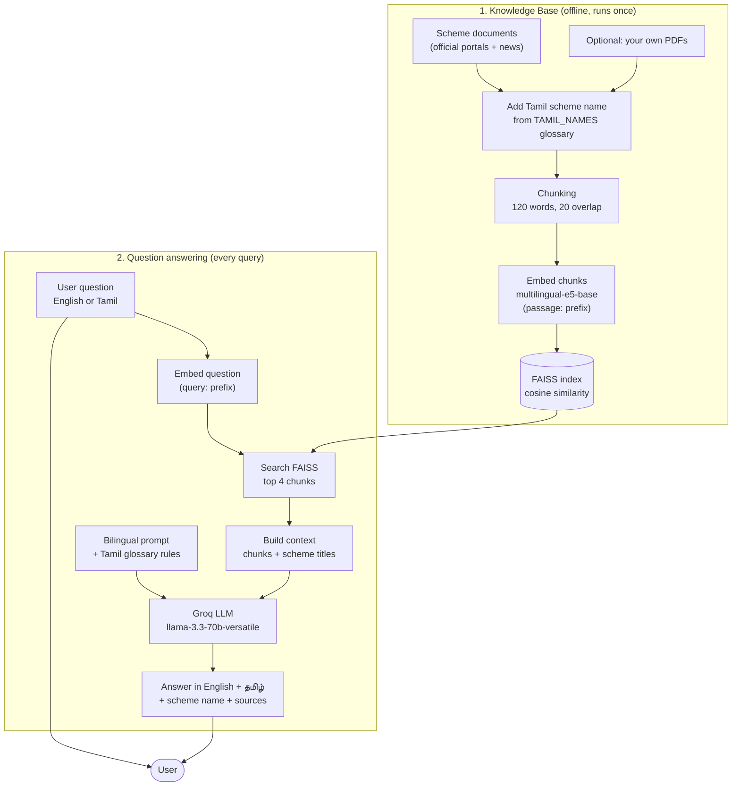
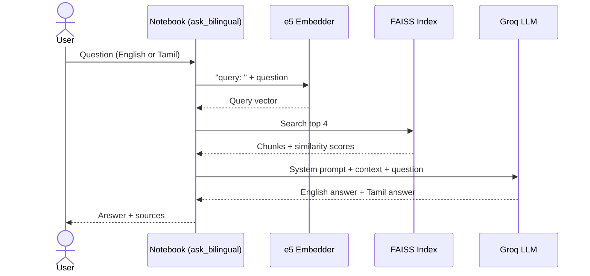

# 🏛️ TN Scheme RAG Assistant

**Bilingual (English/Tamil) RAG assistant for Tamil Nadu government schemes, built with FAISS, multilingual-e5 and Groq LLMs.**

[](https://colab.research.google.com/github/DilliBabu/tn-scheme-rag-assistant/blob/main/TN_Scheme_RAG.ipynb)


Ask a question in English or Tamil. The assistant finds the most relevant scheme text and answers **in both languages**, using only the retrieved documents, with the scheme name and source link.

---

## 🔄 Architecture



### Request flow



---

## ✨ Features

- **Bilingual answers:** every reply has an English part and a Tamil part, whatever language you ask in.
- **Grounded answers:** the model may only use the retrieved context, and says so when it cannot find the answer.
- **Tamil glossary:** fixed official Tamil scheme names, so the model does not invent or mis-spell them.
- **Uncertainty handling:** amounts or changes marked "unconfirmed" in the data are never presented as confirmed.
- **Multilingual retrieval:** `multilingual-e5-base` supports Tamil questions.
- **Automatic model choice:** picks the best available Groq model from a priority list.
- **Bring your own PDFs:** optional cell to index your own documents.

## 📚 Schemes covered

| Scheme | Tamil name |
|---|---|
| Kalaignar Magalir Urimai Thogai (now Madhippumigu Magalir Thittam) | கலைஞர் மகளிர் உரிமைத் தொகை |
| Pudhumai Penn and Tamil Pudhalvan | புதுமைப் பெண் / தமிழ்ப் புதல்வன் |
| Vidiyal Payanam (Vettri Payanam) | விடியல் பயணம் (வெற்றிப் பயணம்) |
| CM Breakfast Scheme (Perunthalaivar Kamarajar) | முதலமைச்சரின் காலை உணவுத் திட்டம் |
| CMCHIS health insurance | முதலமைச்சரின் விரிவான மருத்துவக் காப்பீட்டுத் திட்டம் |
| Naan Mudhalvan skill development | நான் முதல்வன் |

## 🧰 Tech stack

| Part | Tool |
|---|---|
| Embeddings | `intfloat/multilingual-e5-base` (sentence-transformers) |
| Vector search | FAISS (`IndexFlatIP`, normalized vectors) |
| LLM | Groq API (`llama-3.3-70b-versatile`, with fallbacks) |
| PDF loading | pypdf |
| Runtime | Google Colab / Python 3.10+ |

## 🚀 Quick start

**Option 1: Colab (easiest)**

1. Click the **Open In Colab** badge above.
2. Add your key in Colab Secrets as `GROQ_API_KEY` (get one free at [console.groq.com](https://console.groq.com)).
3. Run all cells from top to bottom. The last cell is the interactive Q&A loop.

**Option 2: Local**

```bash
git clone https://github.com/DilliBabu/tn-scheme-rag-assistant.git
cd tn-scheme-rag-assistant
pip install -r requirements.txt
export GROQ_API_KEY="your_key_here"
jupyter notebook TN_Scheme_RAG_fixed.ipynb
```

## 💬 Example questions

```text
Who is eligible for Kalaignar Magalir Urimai Thogai?
How can I get free bus travel?
Do my children get free breakfast in school?
மகளிர் உரிமைத் தொகை எவ்வளவு?
What is the capital of France?   <- should be politely refused
```

## ⚙️ Configuration

| Setting | Default | Where |
|---|---|---|
| `PREFERRED_MODELS` | llama-3.3-70b first | Setup cell |
| `EMBEDDING_MODEL` | `intfloat/multilingual-e5-base` | Setup cell |
| `chunk_size` / `overlap` | 120 / 20 words | Chunking cell |
| `k` (chunks retrieved) | 4 | `retrieve()` |
| `temperature` | 0.1 | Generation cell |

## 📁 Project structure

```text
tn-scheme-rag-assistant/
├── TN_Scheme_RAG_fixed.ipynb   # full pipeline
├── requirements.txt
├── README.md
├── LICENSE
└── .gitignore
```

## ⚠️ Limitations

- The knowledge base is a small hand-compiled set. Scheme rules, amounts and names can change.
- Tamil quality depends on the LLM. Have a Tamil speaker check the glossary and sample answers.
- There is no minimum similarity cutoff yet, so off-topic questions rely on the prompt to refuse.
- Scanned (image-only) PDFs cannot be read without OCR.

## 🗺️ Roadmap

- [ ] Similarity-score cutoff to skip the LLM on off-topic questions
- [ ] Web UI (Streamlit or Gradio)
- [ ] More schemes and automatic data refresh
- [ ] Evaluation set of Tamil and English questions
- [ ] OCR support for scanned PDFs

## 📌 Disclaimer

Scheme details were compiled from official portals and news reports (last checked 11 Oct 2026). This project is not an official government service. Always confirm details on the official portal at [tn.gov.in](https://www.tn.gov.in) or with the concerned department.

## 📄 License

[MIT](LICENSE)
